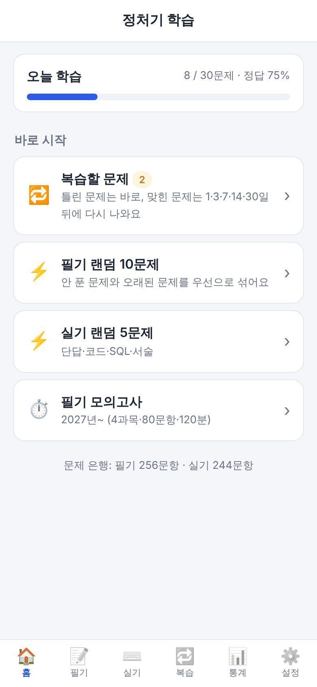
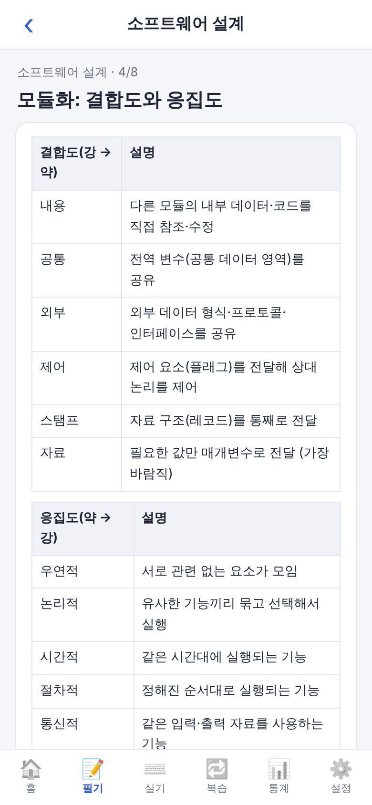
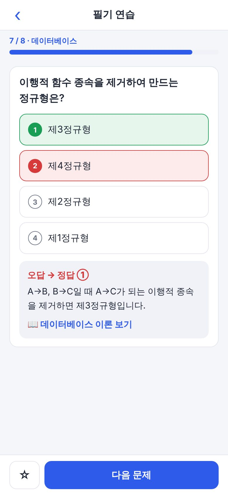
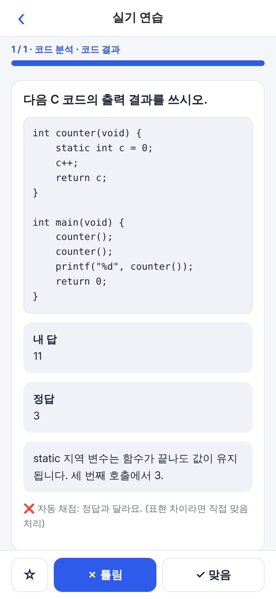
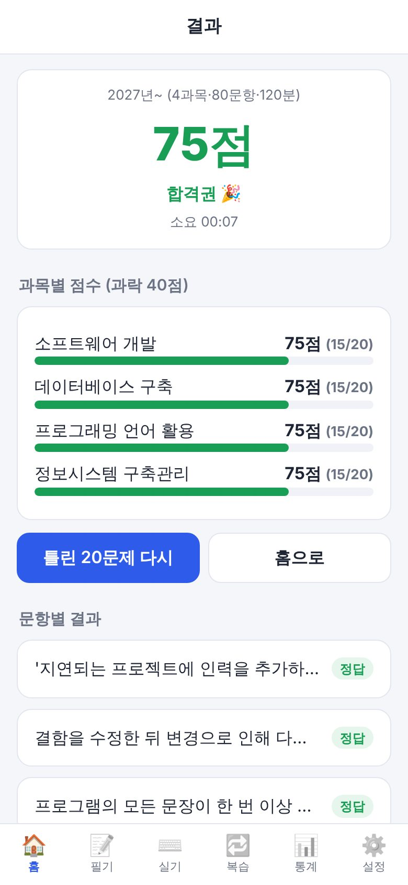

# 정처기 학습 (eip-study-case)

정보처리기사 **필기·실기**를 휴대폰으로 공부하는 **개인용 학습 앱**입니다.
설치·로그인·서버가 필요 없고, 학습 기록은 내 기기(브라우저)에만 저장됩니다. 순수 HTML/CSS/JS(PWA)라 빌드 과정도 없습니다.

<p align="center">
  
  
  
  
  
</p>

## 주요 기능

| 구분 | 내용 |
|---|---|
| 📖 이론 | 교재 목차(5과목·157개 항목)를 따른 핵심 요약·비교표·계산 예제, 출제 빈도(A~D) 필터, 번호·키워드 검색, 항목별 관련 문제 풀기, **읽었어요/헷갈려요** 진도 표시 |
| 📝 필기 | 영역별 연습(즉시 채점·해설), **모의고사**(타이머·문항 이동·과목별 점수·과락 판정), 오답노트, 북마크 |
| ⌨️ 실기 | 단답 · 코드 결과 · SQL 작성 · 서술형. 입력한 답을 **자동 채점**(공백·대소문자·구두점 무시)하고 최종 맞음/틀림은 직접 선택 |
| 🔁 복습 | 간격 반복: 틀리면 바로, 맞히면 **1 → 3 → 7 → 14 → 30일** 뒤에 다시 출제 |
| 📊 통계 | 영역별 정답률, 최근 14일 풀이량, 모의고사 기록, D-day, 하루 목표 |
| 기타 | 다크모드, **오프라인 동작**, 홈 화면 설치, 백업·복원, 내 문제 추가·JSON 가져오기 |

**문제 은행**: 필기 417문항 · 실기 244문항 · 이론 157개 항목 (모두 직접 작성한 학습용 자료).
코드 출력·SQL·계산 문제는 C/Java/Python/SQLite를 실제로 실행해 정답을 검증했습니다.

## 시험 기준

설정에서 두 가지 중 하나를 고르면 모의고사 구성이 바뀝니다.

| | 필기 구성 | 시간 |
|---|---|---|
| ~2026년 | 5과목 · 100문항 (과목당 20) | 150분 |
| 2027년~ | 4과목 · 80문항 (과목당 20) | 120분 |

합격 기준은 필기 *과목당 40점 이상 + 평균 60점 이상*, 실기 *60점 이상*입니다.
2027년 개편 내용은 교재·강의 자료 기준이므로 **응시 전에 [Q-Net](https://www.q-net.or.kr) 공고를 꼭 확인**하세요.

## 시작하기

### 내 컴퓨터에서 실행
```bash
cd eip-study
python3 -m http.server 8000     # → http://localhost:8000
```

### 휴대폰에서 쓰기 (정적 호스팅에 배포)
앱은 정적 파일이라 어디에든 올릴 수 있습니다. **앱 폴더는 `eip-study/`** 입니다.

| 방법 | 설정 |
|---|---|
| **Vercel** (추천, 저장소 연결 후 푸시마다 자동 배포) | Root Directory `eip-study` · Framework Preset `Other` · Build/Output 비워 둠 |
| GitHub Pages | Settings → Pages → *Deploy from a branch* → `main` / `/ (root)` → 주소 끝에 `/eip-study/` (공개 저장소 또는 유료 플랜 필요) |
| Netlify | `eip-study` 폴더를 Netlify Drop에 업로드 (로그인 없이 올리면 1시간 뒤 삭제될 수 있으니 계정에 연결) |

배포 주소를 휴대폰에서 연 뒤 **홈 화면에 추가**하면 앱처럼 실행됩니다.
- iPhone: Safari 공유 버튼 → *홈 화면에 추가*
- Android: Chrome 메뉴 → *앱 설치* / *홈 화면에 추가*

### ⚠️ 학습 기록은 내 기기에만 있어요
기록은 브라우저 저장소에 **주소(도메인)별로 따로** 저장됩니다. 배포 주소를 바꾸거나 브라우저 데이터를 지우거나 기기를 바꾸기 전에는
**설정 → 백업·복원**에서 백업하세요. (홈 화면에 설치한 앱과 일반 브라우저 탭의 저장소가 다를 수 있으니 한쪽만 쓰는 것을 권장합니다.)

## 문제·이론 추가하기

- **앱에서 직접 입력**: 설정 → 문제 추가·관리 (필기/실기 폼)
- **JSON 가져오기**: 설정 → 백업·복원 → 문제 JSON 가져오기 (같은 문제는 중복 추가되지 않음)
- **기본 데이터 수정**: `eip-study/data/` 의 파일을 편집한 뒤 `node eip-study/tools/validate.js` 로 검증

데이터 형식과 규칙(기록 보존을 위한 *맨 뒤에만 추가* 원칙 등)은 **[eip-study/README.md](eip-study/README.md)** 에 있습니다.

## 저장소 구조

```
.
├─ eip-study/                  앱 본체 (이 폴더를 배포)
│  ├─ index.html · style.css · app.js     화면·퀴즈 엔진·복습·통계·설정
│  ├─ data/                               문제·이론 데이터 (written*.js, practical*.js, toc.js, theory1~5.js)
│  ├─ sw.js · manifest.webmanifest        오프라인·설치(PWA)
│  ├─ icons/                              앱 아이콘
│  ├─ tools/validate.js                   데이터 검증 스크립트
│  └─ README.md                           데이터 형식·개발 가이드
├─ docs/screens/               README용 스크린샷
└─ README.md
```

## 알아둘 점

- 문제는 **학습 보조용 연습 문제**이며 실제 기출문제가 아닙니다. 기출은 저작권이 있으므로 본인이 가진 자료를 직접 추가해 쓰세요.
- 이론은 자주 나오는 핵심 위주의 **요약**이라 교재를 대체하지 않습니다. 헷갈리는 부분은 교재·강의로 보충하세요.
- 보기 순서는 문제별로 고정된 무작위 순서로 섞여 있어 정답 번호 패턴으로 찍을 수 없습니다.
- 수정 후 반영이 늦으면(서비스워커 캐시) 앱을 닫았다 열거나 새로고침을 두 번 하세요.
- 이 저장소는 `data-analysis-portfolio`에서 `eip-study-case`로 이름이 바뀌었습니다. 이전 주소는 자동으로 연결됩니다.
